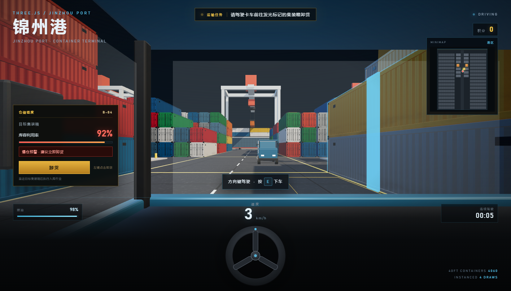
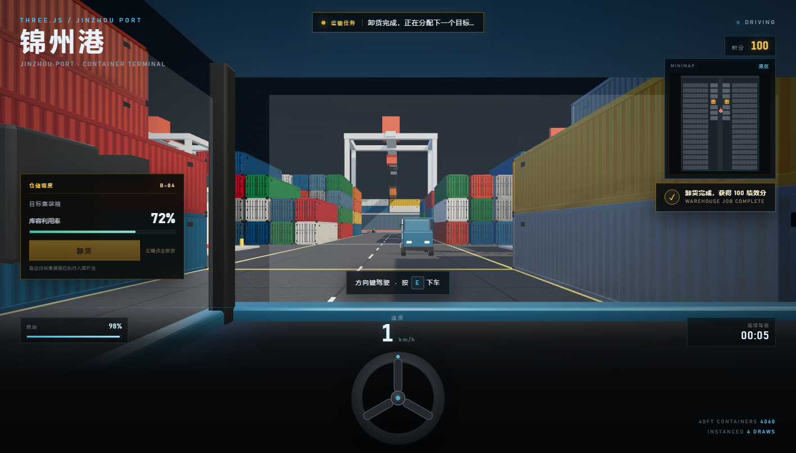

# 锦州港 · 物流数字孪生沙盘

一个面向港口物流业务的专业级 3D 沙盘：TMS 车辆监控、油耗与疲劳预警、加油站补能网络、仓储调度与爆仓预警，以及基于 A* 的 2D 小地图路径规划。


> 已移除旧的“穿过光圈直接拿积分”玩法。现在必须把卡车开到目标集装箱旁的卸货位，完成入库作业后才能获得绩效分。

## 模块一：TMS 车辆监控与油耗

- 驾驶仪表盘实时显示：
  - 当前车速
  - 燃油百分比与油量条
  - 连续驾驶时间 `mm:ss`
- 燃油随驾驶时间下降，车速越高消耗越快；燃油耗尽后发动机熄火
- 连续驾驶超过 **2 分钟**：
  - 屏幕四周红光脉冲闪烁
  - 顶部弹出 `疲劳驾驶预警，请靠边停车休息`
  - 连续驾驶时间变红
- 停车 3 秒或下车即视为休息，疲劳计时与预警自动解除


## 模块二：加油站与补能网络

- 港区设 **4 个加油站**，位置为 `(±20, 0)` 与 `(±20, 70)`：
  - 两个位于中央横向通道
  - 两个位于码头后方的开放通道
- 加油站为 Blender 低模资产：红黄配色雨棚、立柱、双加油机、便利店、价格牌、防撞柱
- 油量低于 **20%** 时提示 `油量不足，请前往加油站`
- 驶入加油站范围、停稳后自动加油：
  - 1.6 秒加油进度
  - 油量回满
  - 扣除 **50 积分**（模拟运费成本）
- 积分不足 50 时无法加油；可以换一辆卡车继续作业


## 模块三：仓储调度与爆仓预警

- 目标不再固定在中央大道，而是随机分布在多条支路旁的**集装箱块堆位**：
  - 详细作业区被切分为 4 个集装箱块
  - 每个目标堆位都带有自己的支路卸货位
  - 全港共 40 个可选目标堆位，每次提货后随机选择，距离当前位置 18 米以上
- 由以下元素标记：
  - 22 米高的黄色发光柱
  - 目标堆位的青色发光竖条与线框
  - 集装箱旁地面的黄色卸货位线框
- 卡车靠近目标后，左侧自动弹出仓储调度面板：
  - 库区编号，例如 `B-04`
  - 实时库容利用率
  - 利用率 > 85% 时显示红色 `爆仓预警 · 建议立即卸货`
  - `卸货` 按钮；指针锁定时左键点击任意位置也可执行
- 点击卸货：
  - 库容利用率下降 20 个百分点（如 92% → 72%）
  - 完成一次入库作业，获得 **100 绩效分**
  - 爆仓预警解除
  - 自动分配下一个目标堆位（距离当前位置 18 米以上）





## 模块四：小地图与 A* 路径规划

- 右上角是纯 **HTML5 Canvas 2D** 小地图，不使用 3D 相机或 RenderTarget
- 灰色块表示集装箱排布
- 红色点表示当前步行玩家或驾驶中的卡车
- 黄色点表示当前目标集装箱
- 红黄加油站图标标记四个补能站
- 绿色线是从当前位置到目标卸货位的 **A* 最短路径**
  - 2 米网格
  - 1.1 米安全间距
  - 8 方向寻路，禁止斜穿障碍角点
  - 移动超过 2 米或目标变化时重新规划，约 0.4 秒节流
- 静态集装箱底图只预渲染一次，逐帧只绘制路径、图标与两个动态点


## 场景与道路

- 约 600 × 400 的深灰色混凝土码头
- **2884 个 40ft 集装箱**：242 个高精模型 + 2642 个 LOD 模型，仅 4 次 draw call
- 详细作业区切分为 4 个集装箱块，块间是可直接行驶的支路：
  - 中央主通道
  - 两条南北向支路（约 `x = ±15.3`、`x = ±28.0`）
  - `z = 32.5` 的东西向横向通道
- 外围 LOD 堆场每 5 列 / 6 行让出一条服务道路，整个港区形成网格化道路系统
- 3 辆 Blender 轻卡，OBB 碰撞箱，卡车之间不能互相穿透
- 海岸线、集装箱船、岸桥、锦州港大门
- 一辆缓慢航行的远洋集装箱船

## 操作

| 操作 | 按键 |
| --- | --- |
| 步行 | `W A S D` |
| 环视 | 鼠标 |
| 上车 / 下车 | `E` |
| 驾驶 | `↑ ↓` 加速/倒车，`← →` 转向 |
| 仓储卸货 | 靠近目标后左键点击 |
| 释放鼠标 | `ESC` |

## 性能

- 2884 个集装箱使用 InstancedMesh，4 次 draw call
- 阴影贴图只烘焙一次；加油站加载后补一次静态更新
- 小地图静态底图一次性生成，动态路径/图标按 30 FPS 绘制
- A* 使用 2 米网格和二叉堆，按需重算，不阻塞主渲染
- 任务光柱/目标标记均不参与阴影贴图

## Blender 资产

- `blender/build_container.py` — 高精 40ft 集装箱
- `blender/build_container_lod.py` — 低模 LOD 集装箱
- `blender/build_truck.py` — 轻卡
- `blender/build_gas_station.py` — 低模加油站（参考低多边形加油站建模思路，全部程序化几何）
- 输出：`assets/container.glb`、`assets/container_lod.glb`、`assets/truck.glb`、`assets/gas_station.glb`

## 运行

```bash
node server.mjs
```

打开 http://127.0.0.1:5178

> Three.js 与 addons 通过 GCore jsDelivr 镜像加载，需要联网。

## 文件结构

```
index.html
server.mjs
assets/
  container.glb
  container_lod.glb
  truck.glb
  gas_station.glb
blender/
  build_container.py
  build_container_lod.py
  build_truck.py
  build_gas_station.py
  container_preview.png
  truck_preview.png
  gas_station_preview.png
preview.png
preview-cab.png
preview-station.png
preview-warehouse.png
preview-unloaded.png
preview-map.png
```
