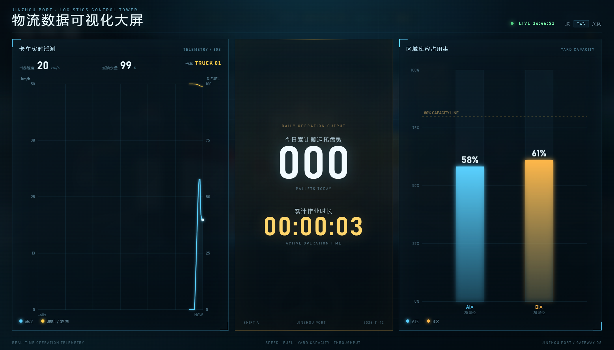
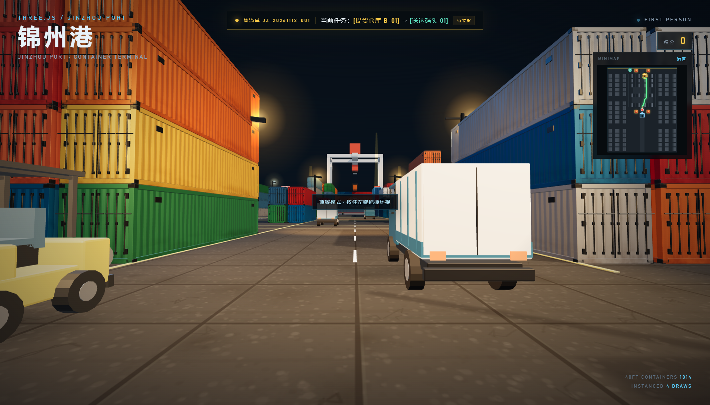
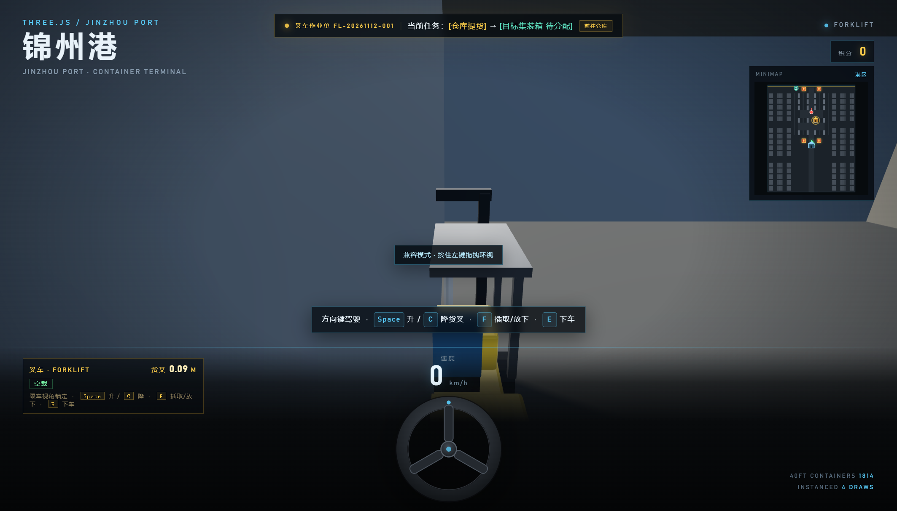

# 锦州港 · 物流数字孪生沙盘

一个面向港口物流业务的专业级 3D 沙盘：TMS 车辆监控、油耗与疲劳预警、4 个加油站、提货—运输—送达闭环、叉车托盘入库作业、全屏物流数据可视化大屏，以及 A* 小地图路径规划。


## 物流数据可视化大屏（TAB）

- 按 **TAB** 全屏呼出，再按 **TAB** 关闭
- 半透明科技感深色背景，叠加网格、扫描线和边角高光
- 左侧 Canvas 折线图：
  - 最近约 60 秒的卡车速度曲线
  - 同步叠加燃油余量曲线
  - 实时显示当前速度、燃油和卡车编号
- 右侧 Canvas 柱状图：
  - A 区、B 区当前库容占用率
  - 显示 80% 容量警戒线
  - 每次托盘入库会更新目标集装箱库容
- 正中间大字 KPI：
  - **今日累计搬运托盘数**
  - **累计作业时长**
  - 今日数据保存在浏览器本地，跨刷新保留
  - 每完成一次托盘入库，托盘数 +1
  - 驾驶卡车或叉车时累计作业时长，大屏打开期间暂停计时
- 大屏打开时暂停车辆输入，数据继续实时刷新；关闭后恢复驾驶
- 大屏数字使用 Consolas / Courier New 等宽字体



## 场景质感、黄昏光效与环境音

- **地面**：程序化沥青/水泥贴图，包含骨料颗粒、混凝土分仓缝、轮胎磨痕、油渍和细裂纹；叠加 bump map，近景有明显凹凸质感
- **集装箱**：新增锈斑、锈水垂流、底部锈蚀带和污渍；通过 `roughnessMap` 让锈蚀区域更粗糙，高模与 LOD 集装箱都应用
- **黄昏/夜景光效**：
  - 暖色低角度主光 + 冷色天光补光
  - 10 盏港口灯：仓库门前高杆灯、中央大道路灯、码头岸桥探照灯
  - 每盏灯都有 `SpotLight` 光池和加色光晕 sprite，远处能看到灯光轮廓
- **环境音效**（全部由 WebAudio 实时合成，不依赖外部音频链接）：
  - 进入场景后的低沉港口环境底噪
  - 叉车启动时的引擎点火/怠速声
  - 货叉上升、下降时的液压嘶声与伺服音
  - 按 TAB 打开/关闭数据大屏时的 UI 提示音
  - 浏览器自动播放策略要求先点击进入场景或按一次键，音频才会解锁
- **数据大屏字体**：Consolas / Courier New / 等宽回退，数字和英文遥测更有终端感



## 叉车托盘作业闭环

- 地图北侧新建 **锦州港仓储中心**，门口摆放 **8 个木托盘**
- 每个托盘上码放 3 箱货物
- 玩家不再用手搬箱，必须驾驶叉车作业：
  - 靠近叉车按 **E** 上车，再按 **E** 下车
  - `↑ ↓` 驾驶，`← →` 转向
  - **Space** 抬升货叉，**C** 或 **Shift** 降下货叉
- 插取逻辑：
  - 把叉车开到仓库门口托盘正前方并对准
  - 将货叉高度调整到托盘插孔高度 **0.16m**（允许 ±0.06m）
  - 按 **F** 插取；高度不符时提示 **“货叉高度不符”**，不会绑定货物
  - 对准并插取成功后，托盘和货物整体绑定到货叉，任务阶段切换为 **“重载运输”**
  - **目标集装箱只有在叉取成功后才会随机分配**，作业单、小地图绿色标记和 A* 路径同步更新
- 安全规范：
  - 载货后叉车最高速度从 **10.0 m/s（约 36 km/h）** 降到 **5.2 m/s（约 18.7 km/h）**
  - 货叉高于 **0.75m** 且正在行驶时，屏幕边缘闪烁红光并提示 **“重心过高，有倾覆危险，请降下货叉！”**
- 卸货入库：
  - 开到绿色目标集装箱旁
  - 按 **C** 将货叉降到地面，再按 **F** 放下托盘和货物
  - 获得 **100 积分**，完成一次标准仓储作业，随后自动生成下一张叉车作业单
  - 送达的托盘约 **4.2 秒**后回到仓库补货，门口始终有托盘可用
  - 8 个托盘全部入库后自动重新布置


> 顶部作业单会显示叉车作业号、当前托盘和目标集装箱；提货前目标显示“待分配”，叉取后才随机选一个集装箱。小地图用蓝色仓库图标标记仓库、绿色菱形标记目标，并在驾驶叉车时显示到当前目标的 A* 路径。

## 叉车跟车摄像机防穿墙

叉车采用锁定居中的第三人称跟车视角，并增加摄像机碰撞：

- 从叉车车体锚点向理想摄像机位置发射 `THREE.Raycaster`
- 检测范围内的集装箱、仓库墙体/屋顶、卡车等障碍物
- 如果理想摄像机位置被挡住：
  - 摄像机自动沿射线拉近到障碍物前方
  - 保持叉车在画面中央，不穿进集装箱或墙体
- 障碍物消失后：
  - 摄像机平滑退回原本的跟车距离
  - 拉近即时生效，退回使用阻尼插值，避免视角抖动



## 提货 → 运输 → 送达闭环

- 顶部物流单 UI 实时显示：
  - 物流单号，例如 `JZ-20261112-001`
  - `当前任务：[提货仓库 A-03] → [送达码头 02]`
  - 当前阶段：`待装货` / `运输中` / `叉车入库中`
- 当卡车驶到指定提货仓库旁，按 **F** 装货：
  - 卡车车顶出现一个橙色货箱模型
  - 任务阶段切换为“运输中”
  - 青色码头泊位光标、A* 路径同步切换到送达码头
- 到达码头泊位后，按 **F** 卸货：
  - 货箱从卡车上消失
  - 获得 **100 积分**
  - 自动触发叉车堆叠动画
  - 动画结束后自动生成下一张物流单
- 只有一辆卡车；中途下车后，装好的货箱仍留在车上，返回驾驶即可继续送达


## 叉车堆叠

送达卸货后，Blender 低模叉车会：

1. 从泊位旁自动驶向刚卸下的货箱
2. 降下货叉、抬起货箱
3. 将货箱运到泊位旁的堆场
4. 把货箱放到集装箱堆上方
5. 自动退场，随后生成下一单


- 叉车资产：`assets/forklift.glb`
- 建模脚本：`blender/build_forklift.py`
- 模型预览：`blender/forklift_preview.png`

## TMS 车辆监控

- 仪表盘显示车速、燃油百分比、连续驾驶时间
- 燃油随驾驶时间下降，车速越高消耗越快
- 连续驾驶超过 **2 分钟**：
  - 屏幕边缘红光脉冲
  - 顶部提示 `疲劳驾驶预警，请靠边停车休息`
- 停车 3 秒或下车后疲劳计时自动解除


## 加油站

- 港区共有 **4 个加油站**：
  - 南区：`(±20, -66)`
  - 北区：`(±20, 70)`
- 均位于作业区，不在主路中间
- 加油站放大 **1.45 倍**，加油半径 10.5m
- 有独立碰撞箱：四个立柱、加油机岛、大型便利店、价格牌立柱
- 油量低于 20% 时提示；停稳后自动加油，油量回满并扣除 50 积分


## 驾驶手感与碰撞

- 转弯速率由 1.18 提升到 2.05，转弯半径明显变小
- 倒车最高速度从 3.2 m/s 提升到 5.5 m/s
- 卡车碰撞半长/半宽 **2.2 × 0.82m**
- 卡车障碍探测点间距 **1.35m**，探测半径 **0.48m**
- 叉车车身探测半径 **0.58m**，前向探测点 **0.82m / 半径 0.45m**
- 叉车对卡车的避让半径 **0.42m**
- 卡车对叉车增加独立碰撞检测，叉车碰撞半径 **1.15m**
- 双方不会再直接穿过彼此

## 小地图与 A*

- 纯 HTML5 Canvas 2D，不使用 3D 相机
- 颜色区分：
  - **琥珀色**：提货仓库
  - **青色**：送达码头
  - 红黄色：加油站
  - 红色：当前玩家/卡车
  - 绿色：A* 最短路径
- 当前阶段目标有脉冲圈
- A* 使用 2 米网格、1.1 米安全间距、8 方向寻路
- 静态集装箱底图只预渲染一次，逐帧只绘制路径、图标和动态点


## 场景与道路

- 约 600 × 400 的混凝土码头
- **1814 个 40ft 集装箱**：242 个高精模型 + 1572 个 LOD 模型，4 次 draw call
- 4 个详细集装箱块
- 两条南北向支路净宽约 **18m**，外围服务道路约 **11.4m**
- 1 辆 Blender 轻卡，带紧凑 OBB 碰撞
- 海面、集装箱船、岸桥、锦州港大门

## 操作

| 操作 | 按键 |
| --- | --- |
| 步行 | `W A S D` |
| 环视 | 鼠标；Pointer Lock 不可用时按住左键拖拽 |
| 上/下叉车、上/下卡车 | `E` |
| 叉车货叉上升 / 下降 | `Space` / `C` 或 `Shift` |
| 叉车插取/放下托盘、卡车装卸货 | `F` |
| 驾驶卡车或叉车 | `↑ ↓` 加速/倒车，`← →` 转向 |
| 物流数据大屏 | `TAB` 呼出 / 关闭 |
| 释放鼠标 | `ESC` |

## 在线访问

**https://dggsdgds.github.io/logistics-3d-park/**

## 运行

```bash
node server.mjs
```

打开 http://127.0.0.1:5178

> Three.js 与 addons 通过 GCore jsDelivr 镜像加载，需要联网。

## 安全与本地配置

当前版本是纯前端静态页面 + 零依赖静态服务器：

- 代码中**没有** DeepSeek/OpenAI API Key、GitHub Token、数据库连接串或 Supabase `service_role` 密钥
- 浏览器端只加载本地资源和 Three.js CDN，不调用需要密钥的 API
- `server.mjs` 只读取可选的 `PORT` 环境变量

### 可选的环境变量

复制模板：

```powershell
Copy-Item .env.example .env
```

Node.js 20.6+ 可以用 `--env-file` 读取本地 `.env`：

```powershell
node --env-file=.env server.mjs
```

或者直接设置环境变量，例如：

```powershell
$env:PORT=5178
node server.mjs
```

`.env` 已被 `.gitignore` 忽略，`.env.example` 只包含占位符。

### 如果以后接入 DeepSeek

不要把 DeepSeek Key 写进 `index.html`、浏览器 JS 或任何公开构建产物。应当由服务端读取：

```js
const apiKey = process.env.DEEPSEEK_API_KEY;
```

前端只请求自己的后端接口，由后端代调用 DeepSeek。真实 Key 只放在本地 `.env` 或部署平台的 Secret 中。

### 如果以后接入 Supabase

- 前端可以公开使用 `SUPABASE_ANON_KEY`，但必须配合 Row Level Security 策略
- **绝对不要**把 `SUPABASE_SERVICE_ROLE_KEY` 放进前端、GitHub、公开构建产物或 `.env.example`
- 需要 service_role 的操作只能放在私有服务端，并通过 `process.env.SUPABASE_SERVICE_ROLE_KEY` 读取
- 当前项目没有写入任何 Supabase 密钥

## 文件结构

```
.env.example
.gitignore
index.html
server.mjs
assets/
  container.glb
  container_lod.glb
  truck.glb
  gas_station.glb
  forklift.glb
blender/
  build_container.py
  build_container_lod.py
  build_truck.py
  build_gas_station.py
  build_forklift.py
preview.png
preview-cab.png
preview-camera-collision.png
preview-dashboard.png
preview-night.png
preview-dock.png
preview-forklift.png
preview-forklift-job.png
preview-map.png
preview-pallet-complete.png
preview-pallet-danger.png
preview-pallet-engaged.png
preview-station.png
preview-warehouse.png
```
