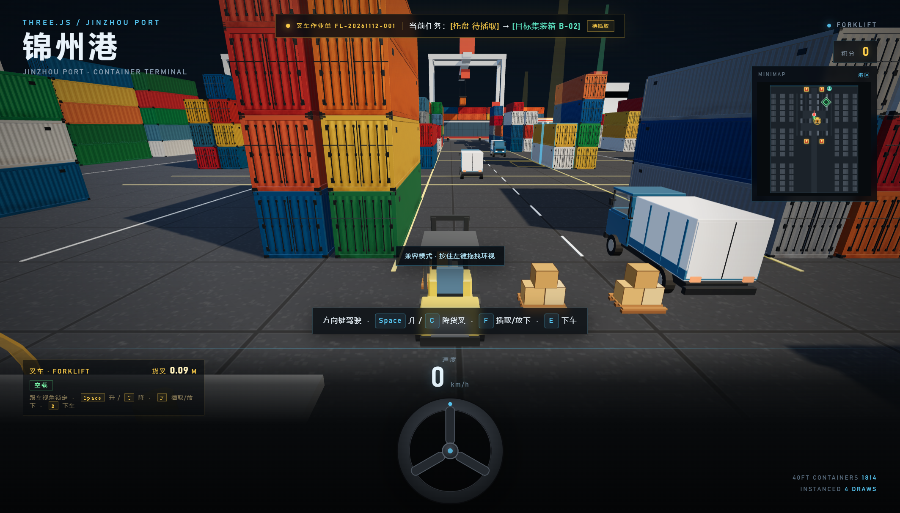
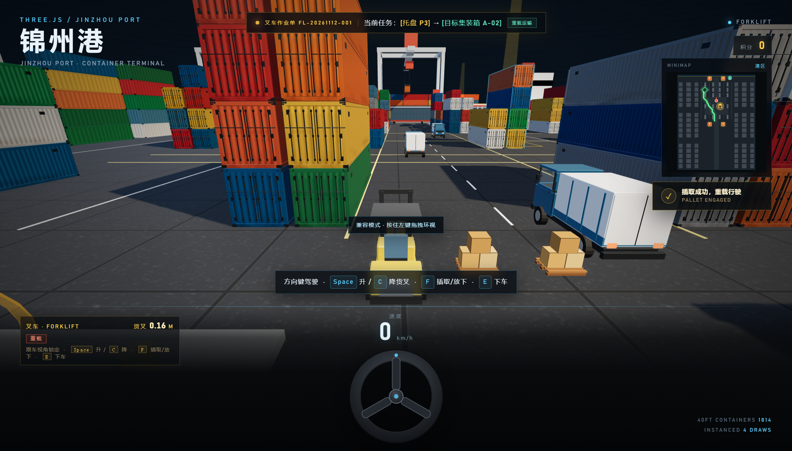
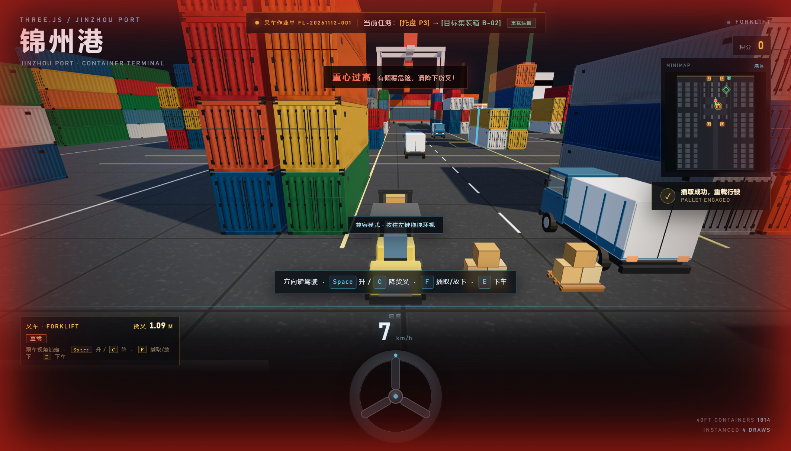
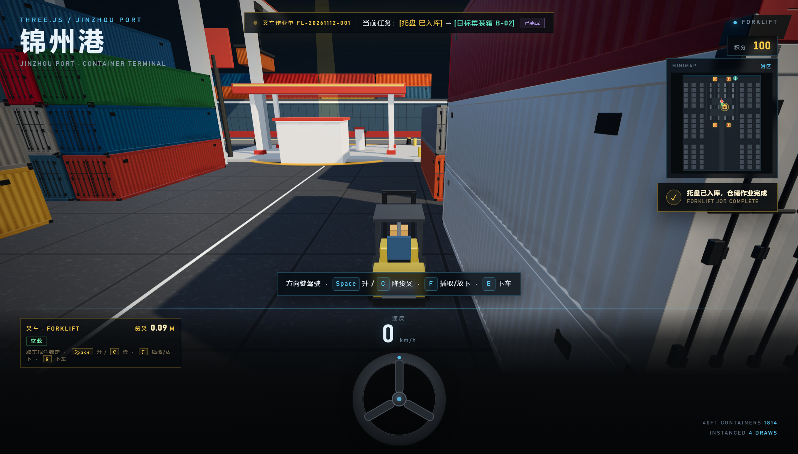
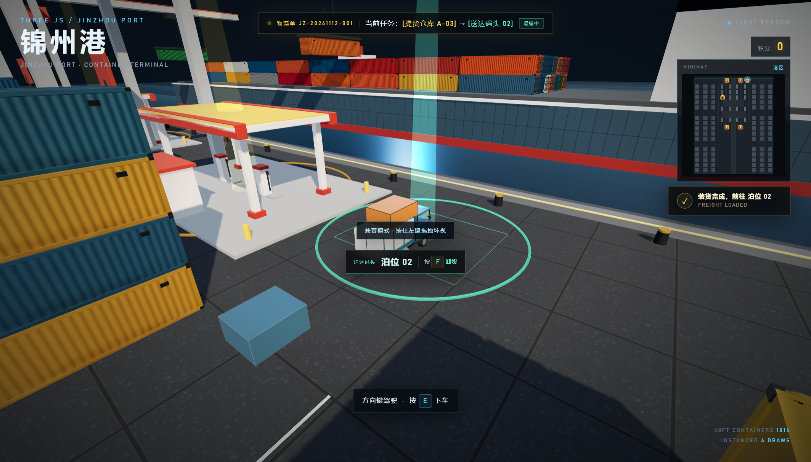
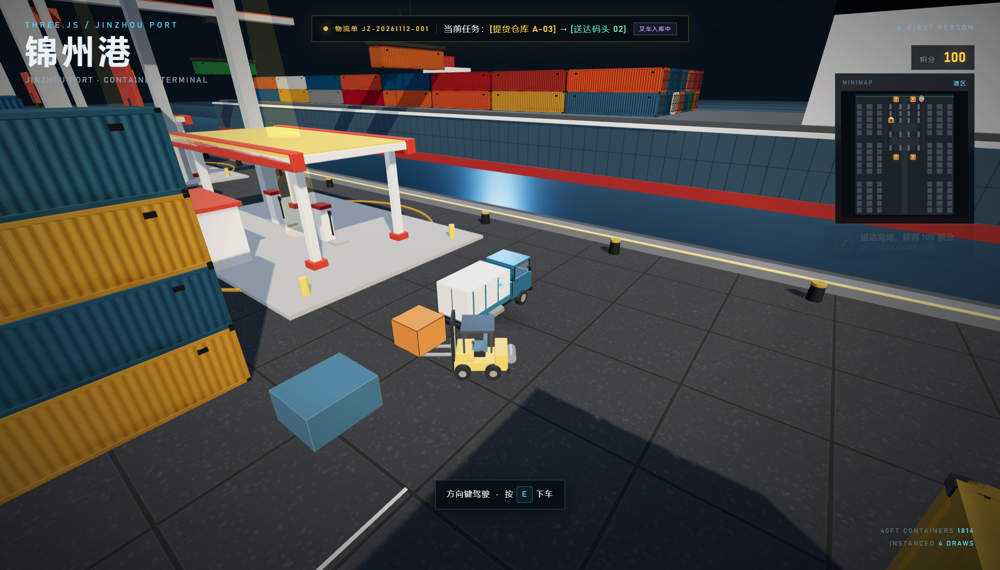
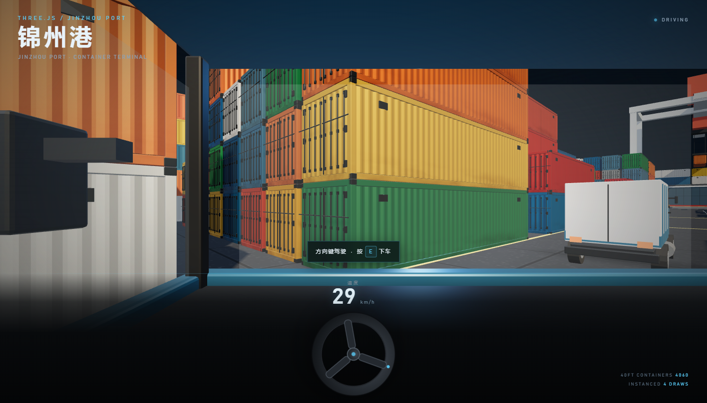
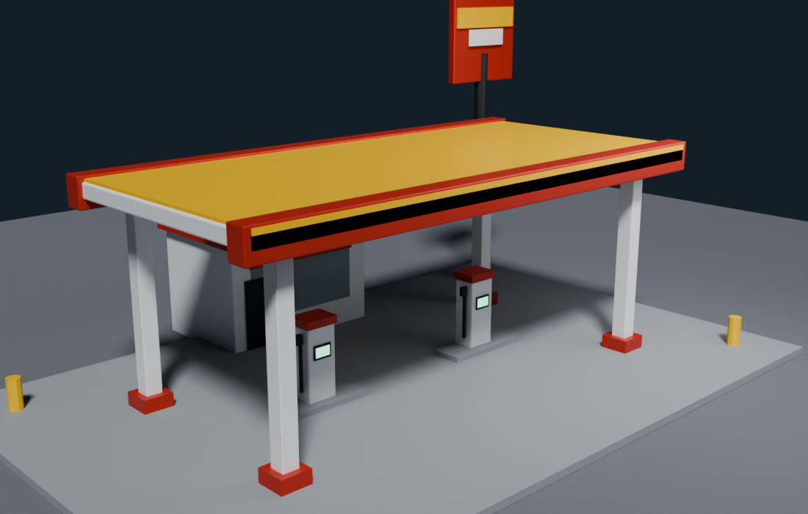
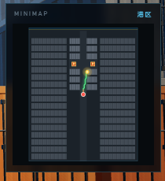

# 锦州港 · 物流数字孪生沙盘

一个面向港口物流业务的专业级 3D 沙盘：TMS 车辆监控、油耗与疲劳预警、4 个加油站、提货—运输—送达闭环、叉车托盘入库作业，以及 A* 小地图路径规划。


## 叉车托盘作业闭环

- 出生点旁生成 **3 个木托盘**，每个托盘上码放 3 箱货物
- 玩家不再用手搬箱，必须驾驶叉车作业：
  - 靠近叉车按 **E** 上车，再按 **E** 下车
  - `↑ ↓` 驾驶，`← →` 转向
  - **Space** 抬升货叉，**C** 或 **Shift** 降下货叉
- 插取逻辑：
  - 把叉车开到托盘正前方并对准
  - 将货叉高度调整到托盘插孔高度 **0.16m**（允许 ±0.06m）
  - 按 **F** 插取；高度不符时提示 **“货叉高度不符”**，不会绑定货物
  - 对准并插取成功后，托盘和货物整体绑定到货叉，任务阶段切换为 **“重载运输”**
- 安全规范：
  - 载货后叉车最高速度从 **3.8 m/s** 降到 **1.9 m/s**
  - 货叉高于 **0.75m** 且正在行驶时，屏幕边缘闪烁红光并提示 **“重心过高，有倾覆危险，请降下货叉！”**
- 卸货入库：
  - 开到绿色目标集装箱旁
  - 按 **C** 将货叉降到地面，再按 **F** 放下托盘和货物
  - 获得 **100 积分**，完成一次标准仓储作业，随后自动生成下一张叉车作业单
  - 3 个托盘全部入库后自动重新布置









> 顶部作业单会显示叉车作业号、当前托盘和目标集装箱；小地图用绿色菱形标注目标位置，并在驾驶叉车时显示到目标的 A* 路径。驾驶视角采用锁定居中的第三人称跟车视角，叉车始终位于屏幕中央。

## 提货 → 运输 → 送达闭环

- 顶部物流单 UI 实时显示：
  - 物流单号，例如 `JZ-20261112-001`
  - `当前任务：[提货仓库 A-03] → [送达码头 02]`
  - 当前阶段：`待装货` / `运输中` / `叉车入库中`
- 当卡车驶到指定提货仓库旁，按 **F** 装货：
  - 卡车车顶出现一个橙色货箱模型
  - 任务阶段切换为“运输中”
  - 青色码头泊位光标、A* 路径同步切换到送达码头
- 到达码头泊位后，按 **F** 卸货：
  - 货箱从卡车上消失
  - 获得 **100 积分**
  - 自动触发叉车堆叠动画
  - 动画结束后自动生成下一张物流单
- 如果中途换乘其他卡车，装货卡车与货箱仍保留，需要驾驶原车完成送达



## 叉车堆叠

送达卸货后，Blender 低模叉车会：

1. 从泊位旁自动驶向刚卸下的货箱
2. 降下货叉、抬起货箱
3. 将货箱运到泊位旁的堆场
4. 把货箱放到集装箱堆上方
5. 自动退场，随后生成下一单



- 叉车资产：`assets/forklift.glb`
- 建模脚本：`blender/build_forklift.py`
- 模型预览：`blender/forklift_preview.png`

## TMS 车辆监控

- 仪表盘显示车速、燃油百分比、连续驾驶时间
- 燃油随驾驶时间下降，车速越高消耗越快
- 连续驾驶超过 **2 分钟**：
  - 屏幕边缘红光脉冲
  - 顶部提示 `疲劳驾驶预警，请靠边停车休息`
- 停车 3 秒或下车后疲劳计时自动解除



## 加油站

- 港区共有 **4 个加油站**：
  - 南区：`(±20, -66)`
  - 北区：`(±20, 70)`
- 均位于作业区，不在主路中间
- 加油站放大 **1.45 倍**，加油半径 10.5m
- 有独立碰撞箱：四个立柱、加油机岛、大型便利店、价格牌立柱
- 油量低于 20% 时提示；停稳后自动加油，油量回满并扣除 50 积分



## 驾驶手感与碰撞

- 转弯速率由 1.18 提升到 2.05，转弯半径明显变小
- 倒车最高速度从 3.2 m/s 提升到 5.5 m/s
- 碰撞体略微收窄，并加入：
  - 碰撞后的轻微回弹
  - 原地转向脱困
  - 更快的倒车脱离
- 减少卡车在加油站、集装箱角落卡死的情况

## 小地图与 A*

- 纯 HTML5 Canvas 2D，不使用 3D 相机
- 颜色区分：
  - **琥珀色**：提货仓库
  - **青色**：送达码头
  - 红黄色：加油站
  - 红色：当前玩家/卡车
  - 绿色：A* 最短路径
- 当前阶段目标有脉冲圈
- A* 使用 2 米网格、1.1 米安全间距、8 方向寻路
- 静态集装箱底图只预渲染一次，逐帧只绘制路径、图标和动态点



## 场景与道路

- 约 600 × 400 的混凝土码头
- **1814 个 40ft 集装箱**：242 个高精模型 + 1572 个 LOD 模型，4 次 draw call
- 4 个详细集装箱块
- 两条南北向支路净宽约 **18m**，外围服务道路约 **11.4m**
- 3 辆 Blender 轻卡，带 OBB 碰撞
- 海面、集装箱船、岸桥、锦州港大门

## 操作

| 操作 | 按键 |
| --- | --- |
| 步行 | `W A S D` |
| 环视 | 鼠标；Pointer Lock 不可用时按住左键拖拽 |
| 上/下叉车、上/下卡车 | `E` |
| 叉车货叉上升 / 下降 | `Space` / `C` 或 `Shift` |
| 叉车插取/放下托盘、卡车装卸货 | `F` |
| 驾驶卡车或叉车 | `↑ ↓` 加速/倒车，`← →` 转向 |
| 释放鼠标 | `ESC` |

## 在线访问

**https://dggsdgds.github.io/logistics-3d-park/**

## 运行

```bash
node server.mjs
```

打开 http://127.0.0.1:5178

> Three.js 与 addons 通过 GCore jsDelivr 镜像加载，需要联网。

## 文件结构

```
index.html
server.mjs
assets/
  container.glb
  container_lod.glb
  truck.glb
  gas_station.glb
  forklift.glb
blender/
  build_container.py
  build_container_lod.py
  build_truck.py
  build_gas_station.py
  build_forklift.py
preview.png
preview-cab.png
preview-dock.png
preview-forklift.png
preview-forklift-job.png
preview-map.png
preview-pallet-complete.png
preview-pallet-danger.png
preview-pallet-engaged.png
preview-station.png
```
