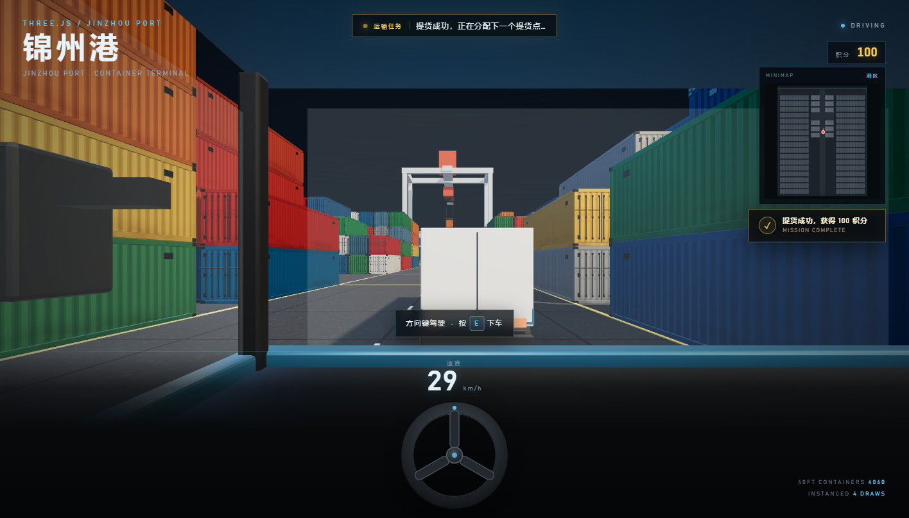

# 锦州港 · 集装箱码头 3D Demo

一个用 Three.js + Blender 资产搭建的港口集装箱码头，第一人称漫游、可驾驶卡车，并带有提货任务、积分和 2D 小地图系统。


提货成功提示：



驾驶 HUD（完整方向盘、速度表、透明车窗）：


## 任务系统

- 在港区中央通道的安全提货点生成**黄色光柱 + 发光光圈**
- 屏幕顶部显示任务条：`请驾驶卡车前往目标点提货`
- 驾驶卡车穿过光圈后：
  - 光圈和光柱消失
  - 右上角弹出 `提货成功，获得 100 积分`
  - 积分实时增加 100
  - 1.1 秒后在另一个安全提货点随机生成新的光圈
- 新的提货点会避开卡车当前位置 22 米以上，不会立刻重复触发
- 积分显示在右上角，靠近小地图，实时更新

## 小地图系统

- 右上角使用 **纯 HTML5 Canvas 2D** 绘制，不使用 3D 相机、不创建 RenderTarget
- 灰色块表示集装箱排布
- 小红点表示当前玩家/驾驶中的卡车
- 小黄点表示当前任务光圈位置
- 红点、朝向线和黄点以 30 FPS 刷新；灰色底图只预渲染一次
- 开车或步行移动时，红点位置实时更新

## 场景与驾驶

- 约 600 × 400 的深灰色混凝土码头
- **4060 个 40ft 集装箱**：中央 412 个高精模型 + 两侧 3648 个 LOD 模型
- 中央约 14.4 m 宽主通道
- **3 辆 Blender 轻卡**
  - 靠近按 **E** 上车，再按 **E** 下车
  - **↑ / ↓** 加速、倒车，**← / →** 转向
  - 卡车和卡车之间有 OBB 碰撞箱，不能互相穿透
  - 步行时玩家也会被车身挡住
- 远海有一艘缓慢横向航行的集装箱船
- 岸桥、停靠货船、海水、系缆桩、锦州港大门

## 驾驶 HUD

- 深灰仪表台，完整圆形方向盘（随转向旋转）
- 实时数字速度表（`速度 29 km/h`）
- 只保留屏幕中央的黑底操作提示，左下角重复文字已隐藏
- 挡风玻璃和侧窗透明，A/B 柱为深色细框

## 性能

- 4060 个集装箱只用 **4 个 InstancedMesh / 4 次 draw call**
- 高精模和 LOD 模分工，静态阴影只烘焙一次
- 小地图底图一次性预渲染，逐帧只做一次 `drawImage` 和两个点的绘制
- 任务光柱只增加少量透明网格，不参与阴影贴图
- 在 RTX 4060 Laptop GPU 的 Edge 硬件加速环境下实测约 **166 rAF/s**

## Blender 资产

- `blender/build_container.py` — 高精 40ft 集装箱（瓦楞钢板、锁杆、角件、烘焙贴图）
- `blender/build_container_lod.py` — 低模 LOD 集装箱
- `blender/build_truck.py` — 轻型卡车（透明车窗、开放式驾驶舱、深色细 A/B 柱）
- 输出：`assets/container.glb`、`assets/container_lod.glb`、`assets/truck.glb`

## 运行

```bash
node server.mjs
```

打开 http://127.0.0.1:5178

> Three.js 与 addons 通过 jsDelivr 的 Gcore 镜像加载，需要联网。

## 文件结构

```
index.html
server.mjs
assets/
  container.glb
  container_lod.glb
  truck.glb
blender/
  build_container.py
  build_container_lod.py
  build_truck.py
  container_preview.png
  truck_preview.png
  textures/container_basecolor.png
preview.png
preview-mission.png
preview-cab.png
```
