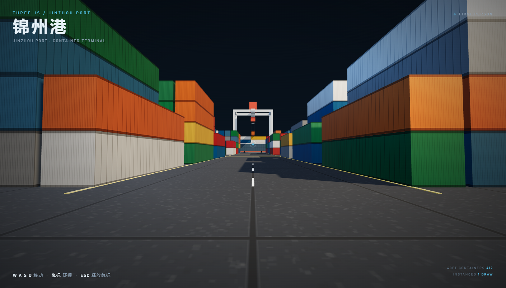

# 锦州港 · 集装箱码头 3D Demo

一个完全用 Three.js（CDN 引入）程序化生成的港口集装箱码头场景，支持第一人称漫游。



## 场景内容

- 600 × 400 的深灰色混凝土码头地面，带混凝土板缝与码头岸线
- **412 个 40ft 集装箱**，按真实尺寸 `2.44 × 2.59 × 12.19 m` 生成
  - 左右各 8 列、每列 6 排，堆叠 2–4 层
  - 红、蓝、绿、黄、橙、灰、白等颜色随机分配，每个集装箱都有轻微色差
  - 中央留出约 **14.4 m 宽的主通道**，另有横向通道可以穿行
- 码头岸桥（STS 龙门吊）、停靠的集装箱船、海水、系缆桩
- “锦州港 / JINZHOU PORT” 大门
- 暖色太阳平行光 + PCFSoft 柔化阴影
- 第一人称漫游：点击锁定鼠标、自由环视、WASD 移动
- 集装箱、岸桥腿、大门立柱均有简单碰撞

## 金属质感

- 集装箱使用 **MeshStandardMaterial**，`metalness = 0.8`、`roughness = 0.6`
- 通过 **RoomEnvironment + PMREMGenerator** 生成环境贴图（IBL），金属表面会反射环境光
- 程序化生成的 **波浪瓦楞 bump map**：竖向波纹 + 上下横梁 + 角柱，配合 `bumpScale = 0.1`
- 额外加入 **AmbientLight**，与半球光、太阳光配合，让阴影过渡更柔和

## 性能优化

- 所有集装箱合并为 **1 个 InstancedMesh**（1 次 draw call），而不是几百个独立 Mesh
- 每个实例通过 `setColorAt` 单独着色，共享同一份几何体和材质
- 场景为静态几何，**阴影贴图只在启动时生成一次**（4096 × 4096），之后不再逐帧重绘
- 环境贴图只在启动时 PMREM 预计算一次，运行时不重新生成
- 移动逻辑只做水平位移和 AABB 碰撞，无逐帧对象创建
- 水面仅通过纹理偏移产生细微流动，不触发阴影更新

## 操作

打开页面后点击画面进入码头：鼠标锁定并隐藏，移动鼠标环视，W/A/S/D 移动，ESC 释放鼠标。

## 运行

```bash
node server.mjs
```

然后打开 http://127.0.0.1:5178

> Three.js 通过 jsDelivr 的 Gcore 镜像加载，需要联网。

## 文件

- `index.html` — 完整场景（HTML + CSS + Three.js 模块）
- `server.mjs` — 零依赖本地静态服务器
- `preview.png` — 第一人称预览截图
